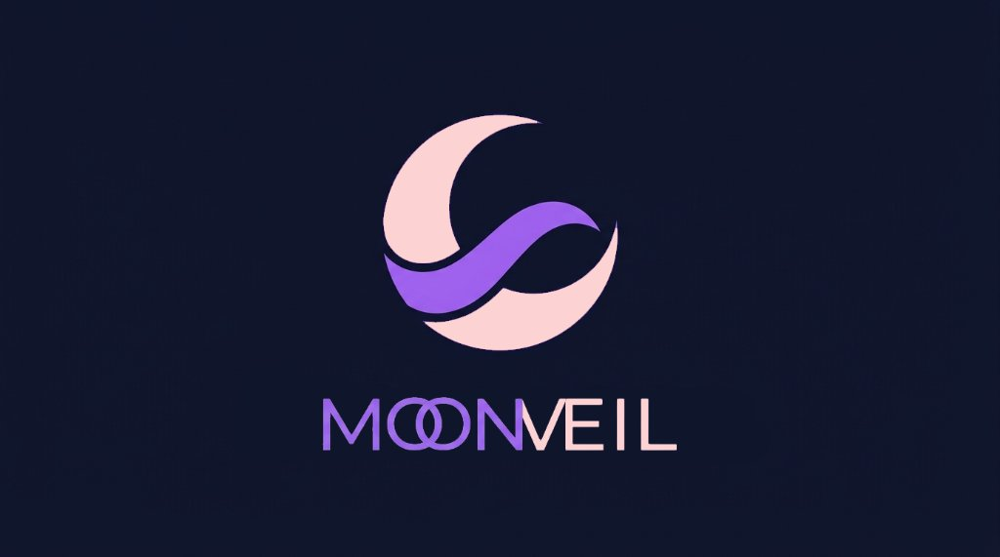

<p align="center">
  
</p>

<h1 align="center">Moonveil (<code>mvl</code>)</h1>

<p align="center">
  A fast, clickable, bilingual (English / Français) terminal network scanner, subnet radar, and port inspector for Linux — authored by <strong>Viectra</strong>.
</p>

<p align="center">
  
</p>

---

## Highlights

- **Moonveil Visual Identity**: Cosmic navy (`#0D0F22`), electric **MOON** violet (`#9B59F6`), and warm **VEIL** crescent peach (`#F7CDBE`) TrueColor interface featuring a half-block Moonveil emblem, animated launch shimmer, Crescent Scan Wave bar, and smooth 24-bit subpixel RTT charts.
- **Bilingual UI (English & Français)**: Switch seamlessly at any time in **Settings -> Language / Langue** or start directly with `--lang fr` / `--lang en`.
- **100% Mouse Clickable Over Local TTY & SSH**: Built-in stateful ANSI/SGR 1006 input decoder handles fragmented SSH terminal packets cleanly. Click sidebar tabs, interface pills, column sort headers, host rows (double-click to deep scan), trust stars, port filter tabs, collapsible closed-port rows, `16×16` Subnet Radar tiles, and one-click exports.
- **Smart Device Identification**: Combines `/etc/hosts`, DNS PTR, mDNS `.local`, NetBIOS Node Status, Tailscale peer names (`tailscale status --json`), and IEEE OUI vendor lookup to display clear human names (`This PC` / `Ce PC`, `Freebox Gateway` / `Passerelle Freebox`, `Canon Printer` / `Imprimante Canon`, etc.).
- **Clean 3-View Layout & Accurate Port Intelligence (`In Use` • `Open` • `Closed`)**:
  - **Hosts**: Searchable host table + detailed inspector with RTT waveform, TCP socket PID/process attribution (`In Use` strictly matched to owning listening/remote sockets), live HTTP `<title>` / TLS / SSH banner grabbing, Wake-on-LAN (`WoL`), continuous Ping, rename modal, and expandable closed ports.
  - **Subnet Radar**: Interactive `16×16` (`.0`–`.255`) IPv4 grid with `/24` pagination for larger subnets (`/16` Docker bridges) and one-click jump to inspector.
  - **Settings**: Port presets (`Quick`, `Standard`, `Full`, `WebDev`, `Custom`), concurrency/timeout tuning, Language selector (`English` / `Français`), 5 TrueColor themes, 6 accent swatches, and `JSON` / `CSV` / `Markdown` exports.
- **Privilege-Smart Engine**: Works immediately as a standard user (`USER`) via TCP probing, `/proc/net` correlation, and mDNS/NBNS, and unlocks raw ICMP TTL detection when installed with `--caps` or run via `sudo`.

---

## Build & Install on Linux

```bash
git clone -b main https://github.com/Viectra/Moonveil.git
cd Moonveil
./scripts/install.sh
```

Optional capability setup for raw ICMP ping without `sudo`:

```bash
./scripts/install.sh --caps
```

Run either `moonveil` or `mvl` (or preview safely with `mvl --demo` or `mvl --demo --lang fr`).

---

## CLI Options

```text
moonveil [OPTIONS]
mvl [OPTIONS]
```

- `--demo` — Preview UI with simulated LAN, Docker, and Tailscale telemetry
- `-i, --iface <NAME>` — Start on a specific Linux interface (`enp6s18`, `wlan0`, `tailscale0`, etc.)
- `-p, --preset <PRESET>` — `quick`, `standard`, `full`, `webdev`, `custom`
- `--ports <EXPR>` — Custom port expression (`22,80,443,8000-8090`)
- `--theme <THEME>` — `moonveil`, `obsidian`, `abyss`, `graphite`, `terminal`
- `--accent <COLOR>` — `violet`, `peach`, `cyan`, `mint`, `rose`, `amber`
- `-l, --lang <LANG>` — Interface language: `en` (English, default) or `fr` (Français)
- `--no-splash` — Skip launch emblem animation
- `-e, --export <json|csv|md> <PATH>` — Run a one-shot scan and write a snapshot file directly

---

## Controls

| Action | Mouse | Keyboard |
| --- | --- | --- |
| Switch views | Click sidebar / topbar tab | `1`–`3` or `Tab` / `Shift+Tab` |
| Start / Stop scan | Click `▶ Scan` / `■ Stop` | `s` or `Space` |
| Cycle port preset | Click preset pill | `p` |
| Deep scan selected host | Double-click host row / `Deep Scan` | `r` |
| Search & smart filter | Click search bar | `/` (`port:22`, `state:in-use`, `vendor:apple`) |
| Trust / Rename device | Click `★ Trusted` / `Rename` | `t` / `n` |
| Switch language / theme | Click in **Settings** | `--lang en\|fr` |
| Navigate & scroll | Click / Wheel scroll | `↑` `↓` / `j` `k` |
| Export JSON | Click `Export JSON` in **Settings** | `e` |
| Help / Quit | Click `? Help` / `× Quit` | `?` / `q` or `Ctrl+C` |

---

## Branch Workflow

- `develop` — Active development (`update: ...`, `fix: ...`)
- `main` — Verified, stable releases

MIT License — Copyright © 2026 **Viectra**
